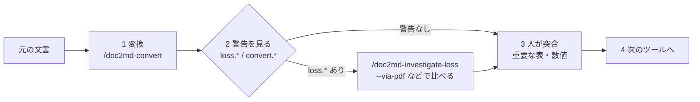

# WORKFLOW — doc2md を実務でどう使うか

Office・PDF・draw.io の文書を Markdown にして、**人が確かめてから** 次のツールや AI に渡すまでの流れです。
コマンドの詳しい使い方は [README](README.md)、大量の設計書を移すときのロット運用は [docs/MIGRATION_GUIDE.md](docs/MIGRATION_GUIDE.md) を参照してください。

## いつ使うか

| きっかけ | やること |
|---|---|
| 設計書（Excel・Word）を AI（Copilot）に読ませて実装・レビューしたい | 変換 → 確かめる → ai-coding や office-review に渡す |
| 設計書が改訂された | 変換し直す → `design-diff` で何が変わったかを見る |
| 表の項目間の整合性（桁・必須・コードの値）を確かめたい | 変換 → `fieldcheck` に渡す |
| 手順書・規程をテキストで検索・管理したい | 変換して Git に入れる |
| 図（業務フロー）を作りたい・直したい | `figspec`（YAML → draw.io）。既存の .drawio は doc2md で要素の一覧にする |

## 流れ



### 1. 変換する

VS Code の Copilot Chat で `/doc2md-convert` と入力し、ファイルかフォルダのパスを指定します。ターミナルなら:

```bash
doc2md 設計書/ -d out/ -r --front-matter -f json -o out/report.json
```

- AI に読ませる設計書には `--front-matter` を付けます（`id` と元ファイルのハッシュが付き、ai-coding で設計書を ID で参照できる）
- 資料一式を AI に渡すなら `--llms-txt` も付けます

### 2. 警告を見る（AI に任せず、人が読む）

| 出たもの | 意味 | すること |
|---|---|---|
| 終了コード 0、警告なし | 構造・文字数とも元と合っている | 3 へ |
| `loss.raw_text` | 元の文字数より出力が少ない（未対応の要素で落ちた可能性） | `/doc2md-investigate-loss` で通常の変換と PDF 経由（`--via-pdf`）を比べる |
| `loss.tables` `loss.table_rows` `loss.headings` など | 認識した表・行・見出しの一部が出力に無い | 該当のシートやページを元ファイルで開いて確かめる。Excel は `--header-row` で見出し行を指定すると直ることが多い |
| `convert.warning` / `convert.note` | 変更履歴・非表示の行・数式の未計算・OCR など、読み方に注意が要る | 内容を読み、必要なら `--track-changes`、`--skip-hidden`、`--recalc` を付けて変換し直す |
| 終了コード 1 | 変換に失敗したファイルがある（`--strict` なら警告も） | `report.json` の `findings` で失敗したファイルと理由を見る |
| 終了コード 2 | 引数・入力の誤り、必要な外部ソフト（LibreOffice・Tesseract）が無い | `doc2md --check-env` で確かめる。データではなく前提の問題 |
| 終了コード 3 | 実行時エラー | ログ（標準エラー）を添えて相談する |

### 3. 人が突合する

AI に渡す前に、**判断の根拠になる部分だけ** 元ファイルと見比べます（全部は見なくてよい）。

- 数値・コード値・桁数の表（項目定義・メッセージ一覧・コード表）
- 結合セル・2 段見出しのある表（列のずれが起きやすい）
- 変更履歴・非表示の行が残っている文書（どちらを正とするか）

ロットで移すときのチェックリストは [MIGRATION_GUIDE の 3 章](docs/MIGRATION_GUIDE.md) にあります。

### 4. 次のツールへ渡す

| 次にやること | 渡し方 |
|---|---|
| 表の整合性を確かめる | `fieldcheck validate out/項目定義.md -r rules.yaml -f json`（office-review） |
| 設計書をレビューする | office-review の `/review`（観点のチェックリストに沿って） |
| 改訂の差分を見る | Excel のまま `design-diff excel --type api --before 旧.xlsx --after 新.xlsx`（design-diff）。Markdown 同士なら `git diff` |
| 実装・単体テストを作る | 変換した Markdown を設計書リポジトリに置き、ai-coding の `/ai-plan <設計書の id>`（[ai-coding の WORKFLOW](https://github.com/shoyo-maya-bot/ai-coding/blob/main/WORKFLOW.md)） |
| 設計書が更新されたか検知する | Front Matter の `source_sha256` を、ai-coding の spec-trace（設計書ドリフト）が見る |

## 守ること

- **元のファイルは書き換えない**（doc2md は出力フォルダにだけ書く）
- **AI の要約・判断は下書き**。数値や仕様の正は元の文書
- 業務の文書を AI に渡してよい範囲は、社内の規程と Copilot の契約で確かめる（[AI_USAGE](https://github.com/shoyo-maya-bot/devtools-workspace/blob/main/docs/AI_USAGE.md)）
- 変換した Markdown を Git に入れるときは、公開範囲（リポジトリが社外から見えないか）を確かめる
